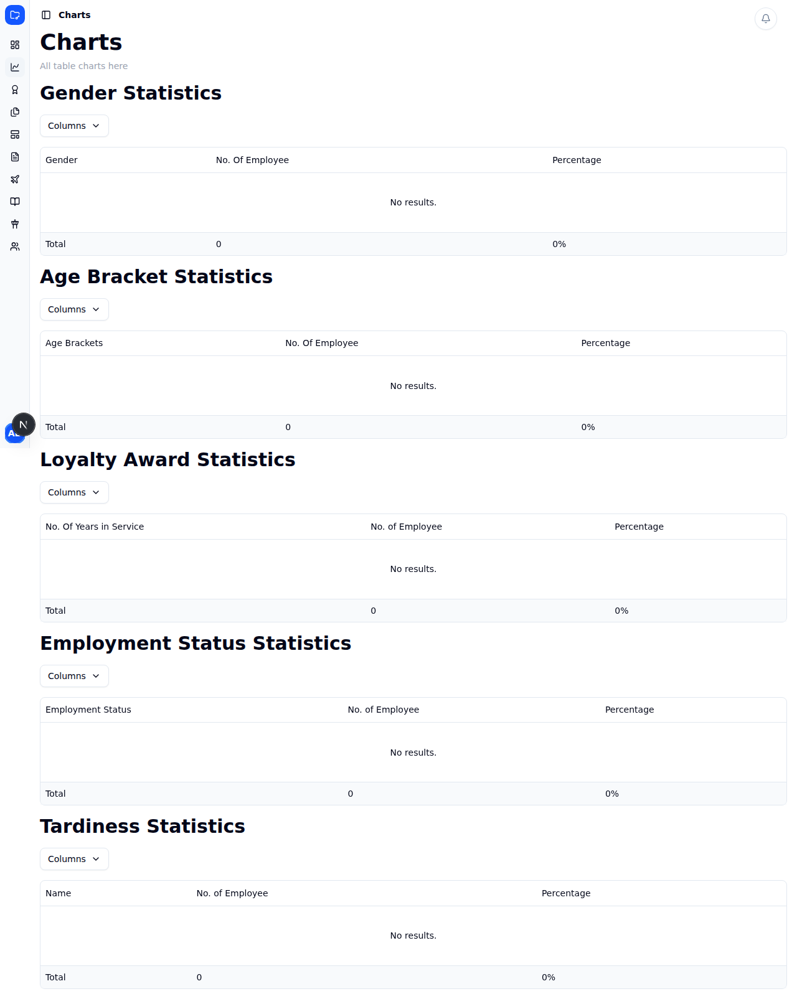
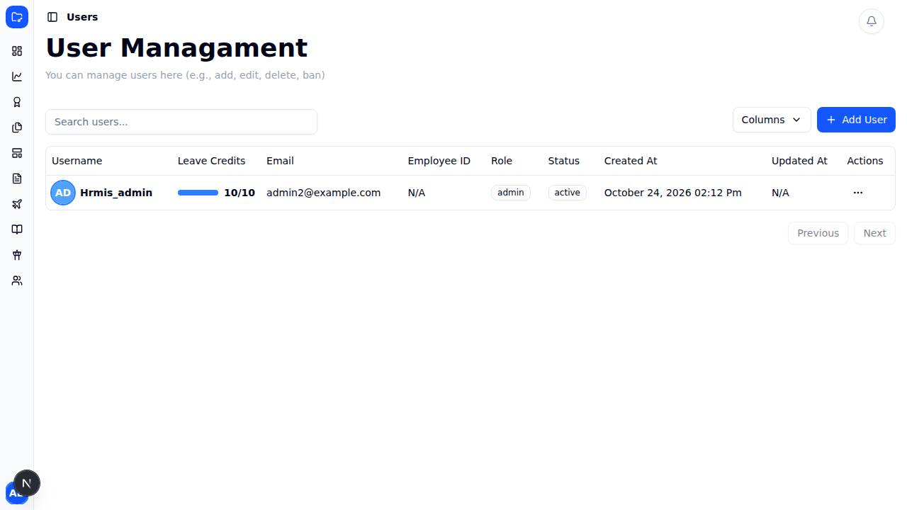
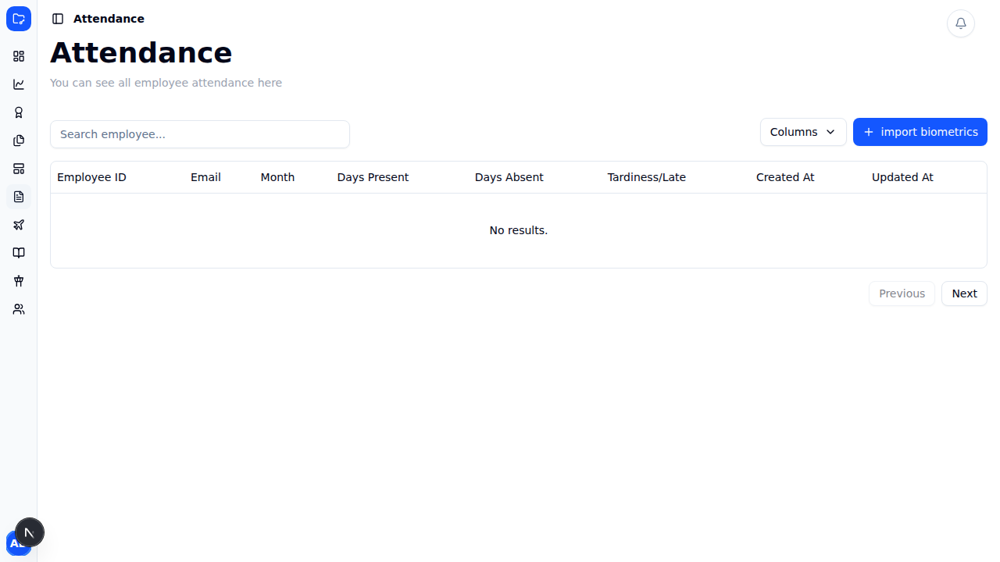
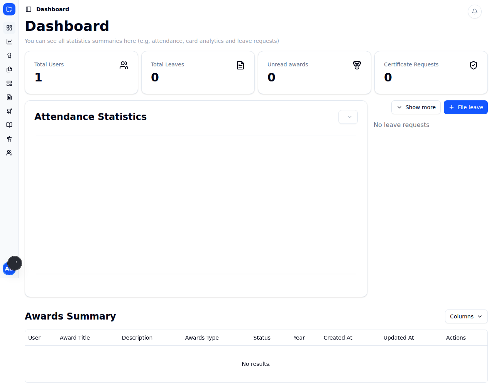

# Reporting — Parity Analysis & Action Items

Source: `Reporting.pdf` (3 pages). This document breaks the spec into **parity
analysis** (what exists today vs. what the spec requires), **prioritized action
items**, **acceptance criteria (ACs)**, a **testing & verification** plan, and
**gaps** found while studying the codebase.

> The PDF mixes English and Cebuano. Cebuano lines are translated inline below so
> nothing is lost.

**Legend**

- Parity status: ✅ Done · 🟡 Partial · ❌ Missing
- Priority: **P0** (core spec, blocking) · **P1** (spec, non-blocking) · **P2** (polish/gap)
- File paths reference the current codebase so each item is actionable. Follow
  the layered architecture in `CLAUDE.md` (UI → service → API route → model →
  response helper) and the testing setup in `docs/TESTING.md`.

---

## 1. Parity matrix (at a glance)

| #   | Requirement                                                        | Today                                                                                                                                                                                    | Status | Priority |
| --- | ------------------------------------------------------------------ | ---------------------------------------------------------------------------------------------------------------------------------------------------------------------------------------- | ------ | -------- |
| 1a  | Employee Master List page (admin)                                  | `users` page exists, but no "master list" report                                                                                                                                         | 🟡     | P0       |
| 1b  | View/Export CSV: All / Permanent / Casual / Elected / Contractual  | No status filter, no CSV export                                                                                                                                                          | ❌     | P0       |
| 1c  | Dynamic Employee Status management (add/edit/delete)               | `users.employment_status` is free-text; options hardcoded `['Permanent','Casual','Elected']` (missing **Contractual**)                                                                   | ❌     | P0       |
| 1d  | Status choices feed employee registration                          | Registration reads the hardcoded array, not a managed table                                                                                                                              | ❌     | P0       |
| 2a  | Charts: View button → employee list per category                   | Charts show **aggregates only**; the only button is a "Columns" visibility toggle                                                                                                        | ❌     | P0       |
| 2b  | Charts: Export button → CSV of employees per category              | No export                                                                                                                                                                                | ❌     | P0       |
| 2c  | Loyalty threshold = exact milestones **10/15/20/25/30/35/40** only | RPC uses **ranges** (`BETWEEN 10 AND 14` → "10 years"), caps at "35+", ignores the threshold table; threshold seed is `(5,10,15,20,25,30,35)` — has an extra **5** and is **missing 40** | 🟡     | P0       |
| 3a  | Employee Service Record page (admin add/edit/delete)               | Existing "service-record" is **PDF certificate generation**, not a data CRUD record                                                                                                      | ❌     | P1       |
| 3b  | Employee can view their Service Record                             | No employee-facing service-record data view                                                                                                                                              | ❌     | P1       |
| 4a  | Attendance list + Export CSV with Weekly/Monthly/Yearly filter     | Attendance has monthly summaries + CSV **import**; no **export**, no weekly/yearly filter                                                                                                | 🟡     | P1       |
| 4b  | Late = time-in after 8:00 AM; Undertime = < 8 hrs/day              | Raw `biometrics` timestamps + DTR derivation exist, but no late/undertime classification report                                                                                          | 🟡     | P1       |

---

## 2. Feature 1 — Employee Master List + dynamic Employee Status

### Spec (PDF p.1)

> Create another page under admin account for **Employee Master List**. The admin
> can view in a table or export to a CSV the list of employees:
> All / Permanent / Casual / Elected / Contractual.
> Create another page for managing **Employee Status** (Permanent, Elected,
> Casual, Contractual, etc.) to be **dynamic** — admin can add, edit, delete.
> The Employee Status options are then selectable during employee registration.

### Current state

- `app/backend/[userId]/users/` — a Users table (CRUD) exists, but it is not a
  report/master-list, has no status filter, and no CSV export (`UsersTable.tsx`
  only has a column-visibility dropdown).
- `users.employment_status` is a **TEXT** column (`database.types.ts`), not a FK
  to a managed table.
- Registration options are **hardcoded**: `app/auth/sign-in/helpers/constants.ts`
  → `export const employmentStatus = ['Permanent', 'Casual', 'Elected'];`
  (note: **"Contractual" is missing**).
- No "Employee Status" management page exists; `helpers/navItems.ts` has no entry.

### Parity gaps

1. No Master List report page with per-category views.
2. No CSV export of employees (all or by category).
3. Employee Status is static text, not a dynamic managed entity.
4. Registration doesn't read from a managed status table.
5. "Contractual" category is absent from the current options.

### Action items

- [ ] **AI-1.1 (P0)** DB: add `employee_status` table (`id`, `name` unique,
      `created_at`, `updated_at`, `archived_at`) via `make migrate-new
  name=employee_status`. Seed `Permanent, Elected, Casual, Contractual`.
- [ ] **AI-1.2 (P0)** DB: migrate `users.employment_status` to reference
      `employee_status` (add `employee_status_id` FK; backfill from existing
      text; keep text column during transition or drop after backfill).
- [ ] **AI-1.3 (P0)** API: `app/api/protected/employee_status/route.ts`
      (+`[id]/route.ts`) with `GET` (list) and `type`-discriminated
      add/edit/delete, delegating to a `model/employee_status.ts` and returning
      response helpers (mirror `leave_categories`).
- [ ] **AI-1.4 (P0)** Service + state: `services/employee_status/…services.ts`
      and a Zustand dialog store (mirror `services/leave_categories`).
- [ ] **AI-1.5 (P0)** UI: admin page
      `app/backend/[userId]/employee-status/page.tsx` with table +
      Add/Edit/Delete dialogs (reuse the leave-categories pattern). Add
      `loading.tsx` + `error.tsx`.
- [ ] **AI-1.6 (P0)** Registration: replace the hardcoded `employmentStatus`
      array in `AddUserDialog.tsx`/`EditUserDialog.tsx` with options fetched from
      `employee_status`. Remove/retire `sign-in/helpers/constants.ts` usage.
- [ ] **AI-1.7 (P0)** UI: Employee Master List page
      `app/backend/[userId]/employee-master-list/page.tsx` — table with a
      category filter (All/Permanent/Casual/Elected/Contractual, data-driven) and
      an **Export CSV** button per the active filter.
- [ ] **AI-1.8 (P0)** API: `app/api/protected/users/master-list/route.ts` —
      `GET` with `?status=` filter returning employees; `?format=csv` streams a
      CSV (`text/csv`, `Content-Disposition: attachment`).
- [ ] **AI-1.9 (P0)** Util: add a reusable **CSV serializer** (rows → CSV string
      with escaping) next to `app/api/helpers/csvHelpers.ts` (which today only
      _parses_ CSV). Client download can reuse `helpers/downloadFile.ts`.
- [ ] **AI-1.10 (P2)** Nav: add "Employee Master List" and "Employee Status" to
      `helpers/navItems.ts` (admin only); confirm both are covered by
      `middlewares/proctedRoutesMiddlware.ts`.

### Acceptance criteria

- [ ] Admin sees an **Employee Master List** page with a category filter.
- [ ] For **All** and each of **Permanent / Casual / Elected / Contractual**, the
      admin can **view** the list and **export** it to CSV; the CSV matches the
      filtered, on-screen rows.
- [ ] Admin can **add / edit / delete** Employee Status on a dedicated page.
- [ ] Deleting/adding a status is reflected in the registration dropdown
      immediately (data-driven, no code change).
- [ ] Employee registration persists the selected status; existing employees'
      statuses are preserved after migration.
- [ ] "Contractual" is selectable.

### Testing & verification

- Unit (`*.test.ts`): CSV serializer (quoting/commas/newlines/empty), status
  option mapping.
- Component (`*.test.tsx`): Master List filter switches rows; Export button
  triggers a download with expected filename; Employee Status Add/Edit/Delete
  dialogs validate input.
- Integration (`*.int.test.ts`, node): `employee_status` route (list + add/edit/
  delete, 400/401/409 on dup) and `users/master-list` route (filter + `csv`
  content-type/body) with mocked Supabase.
- DB/migration: backfill verified (no NULL statuses lost); FK integrity.
- Manual: register a new employee using a newly-added status; export each
  category and diff against the table.

### Screenshots / evidence

See `.claude/reporting/screenshots/` for the naming convention. Capture:
`01-master-list-all.png`, `01-master-list-permanent.png`,
`01-export-csv.png`, `01-employee-status-manage.png`,
`01-registration-status-dropdown.png` (before → after).

---

## 3. Feature 2 — Charts: per-category View/Export + Loyalty threshold fix

### Spec (PDF p.2)

> In the Charts page, add a **View** button to view the list of employees per
> category and an **Export** button to export that list to CSV. (Examples show
> Gender list: `Employee ID, Name, Gender`, and Age list: `Employee ID, Name,
Age`, each with View/Export.)
> **Fix the loyalty award threshold.** Loyalty awards are for service of
> **10, 15, 20, 25, 30, 35, 40 years**.
> Cebuano: _"Muna lng ang mahatagan loyalty awards, if 11 years, wla lng, if 14
> wla man"_ → _"Only these receive loyalty awards; if 11 years, none; if 14,
> none either."_ → **Only exact milestone years qualify** (no in-between years).

### Current state

- `app/backend/[userId]/charts/page.tsx` renders **aggregate** tables
  (Gender/Age/Loyalty/Employment/Tardiness statistics) — counts & percentages.
  The only button is a **Columns** visibility dropdown (`GenderStatisticsTable.tsx`).
- No per-category employee drill-down list; no CSV export.
- Loyalty RPC `supabase/migrations/20260422000000_loyalty_awards_rpc.sql` buckets
  by **range** (`BETWEEN 10 AND 14` → "10 years", … `>= 35` → "35+"), which
  **contradicts the spec** (exact years, and 40 as its own bracket). It also
  **does not read** the `employee_loyalty_threshold` table.
- `supabase/seeds/employee_loyalty_threshold.sql` seeds `(5,10,15,20,25,30,35)`
  — contains an extra **5** and is **missing 40**.

### Parity gaps

1. Charts have no per-category employee **View**.
2. Charts have no **Export CSV**.
3. Loyalty logic is **range-based**, not exact-milestone (spec-breaking).
4. "40 years" bracket missing; "35+" bucket conflates 35 and 40.
5. Threshold config table and the RPC are **out of sync** (RPC ignores it).

### Action items

- [ ] **AI-2.1 (P0)** API: `app/api/protected/users/by-category/route.ts` —
      `GET ?category=gender|age|employment|loyalty&value=<bucket>` returning the
      employee list (`employee_id, name, …`); `?format=csv` for export.
- [ ] **AI-2.2 (P0)** UI: add **View** (opens a dialog/sheet with the employee
      list) and **Export** buttons to each statistics table
      (`GenderStatisticsTable`, `AgeStatisticsTable`, `EmploymentStatusTable`,
      `LoyaltyAwardsTable`). Reuse the CSV serializer from AI-1.9.
- [ ] **AI-2.3 (P0)** DB: rewrite `get_loyalty_award_statistics` to award only
      **exact** years `10,15,20,25,30,35,40` (someone at 11/14/16 → not awarded
      that year). Add a distinct **40** bracket. Decide 35 vs "35+" (spec lists
      40 explicitly, so prefer discrete 35 and 40). New migration via
      `make migrate-new`.
- [ ] **AI-2.4 (P0)** DB/data: correct `employee_loyalty_threshold` seed to
      `(10,15,20,25,30,35,40)` **or** confirm 5 is intentional (see Open
      Questions). Make the RPC **read the threshold table** so it stays
      configurable.
- [ ] **AI-2.5 (P1)** Extract the loyalty-bracket logic into a pure, unit-tested
      TS helper mirroring the SQL (single source of truth for UI labels/tests).

### Acceptance criteria

- [ ] Each charts category has a **View** button showing the employee list
      matching that bucket, and an **Export** button producing a matching CSV.
- [ ] Gender list columns = `Employee ID, Name, Gender`; Age list columns =
      `Employee ID, Name, Age` (per the PDF examples).
- [ ] An employee with exactly 10/15/20/25/30/35/40 years is counted for that
      award; 11, 14, 16, 41 years are **not** awarded.
- [ ] A **40-year** bracket exists and is distinct from 35.
- [ ] The threshold table and RPC agree (changing the table changes results).

### Testing & verification

- Unit: loyalty-bracket pure fn — table-driven cases incl. boundaries
  (9→none, 10→10yr, 11→none, 14→none, 15→15yr, 35→35yr, 40→40yr, 41→none).
- Component: View dialog renders the fetched list; Export triggers download.
- Integration: `users/by-category` route (filter + csv) with mocked Supabase.
- DB: seed a user at each exact/near year and assert `get_loyalty_award_statistics`
  (run against local `supabase start`).
- Manual: cross-check charts counts vs. the exported CSV row counts.

### Screenshots / evidence

`02-charts-view-gender.png`, `02-charts-export-gender.png`,
`02-charts-view-age.png`, `02-loyalty-before.png`, `02-loyalty-after.png`.

---

## 4. Feature 3 — Employee Service Record (data CRUD)

### Spec (PDF p.2)

> Create another page under admin account for **Employee Service Record**. Admin
> can **add** data to the service record and can **edit the date or delete**. The
> employee can only **view** their Service Record in their account.

### Current state

- The existing "service record" is **PDF certificate generation**
  (`app/api/protected/service-record/route.ts`, `ServiceRecordDialog.tsx`,
  `app/helpers/service-record/service-record-form-fields.ts`) used by the
  Requested Documents flow — **not** a data record the admin manages.
- No `service_record` data table, no admin CRUD page, no employee data view.

### Parity gaps

1. No persistent Service Record **data entity** (only PDF export).
2. No admin **add/edit/delete** UI for service-record entries.
3. No employee-facing **view** of their service record.

### Action items

- [ ] **AI-3.1 (P1)** DB: `service_record` table (`id`, `user_id` FK, position/
      designation, status, salary, station/office, `from_date`, `to_date`,
      remarks, `created_at`, `updated_at`, `archived_at`). Migration via
      `make migrate-new`.
- [ ] **AI-3.2 (P1)** API: `app/api/protected/service_record/route.ts`
      (+`[id]`) — `GET` (by user), add/edit/delete via `type` discriminator →
      `model/service_record.ts` → response helpers. Enforce admin-only writes;
      employees can read **only their own** rows (RLS or server-side check).
- [ ] **AI-3.3 (P1)** Admin UI:
      `app/backend/[userId]/service-record/[employeeId]/page.tsx` — table + Add/
      Edit/Delete dialogs (edit must support changing dates).
- [ ] **AI-3.4 (P1)** Employee UI (read-only):
      `app/employee/[userId]/service-record/page.tsx`.
- [ ] **AI-3.5 (P2)** Reconcile naming with the existing PDF "service-record" to
      avoid confusion (e.g., keep PDF export as "Service Record Certificate").
- [ ] **AI-3.6 (P2)** Optional: "Export to PDF/CSV" of the managed record,
      reusing the existing PDF template.

### Acceptance criteria

- [ ] Admin can add a service-record entry for an employee, edit it (incl. the
      date), and delete it.
- [ ] Employee sees their own service record **read-only** and cannot edit.
- [ ] An employee cannot read another employee's service record (authorization).

### Testing & verification

- Component: admin dialogs validate; employee view has no edit controls.
- Integration: `service_record` route CRUD; **authorization** test — employee
  token cannot write or read others' rows (401/403).
- DB: FK + archived_at soft-delete behavior.
- Manual: admin adds → employee sees it; employee edit attempt blocked.

### Screenshots / evidence

`03-admin-service-record.png`, `03-admin-edit-date.png`,
`03-employee-view-readonly.png`.

---

## 5. Feature 4 — Attendance report: export + Weekly/Monthly/Yearly + Late/Undertime

### Spec (PDF p.3)

> View or Export to CSV the list of employees with their attendance, filtered by
> **Weekly / Monthly / Yearly**.
> Cebuano: _"Ang late is mag time in lapaw sa 8:00 am"_ → **Late = time-in after
> 8:00 AM**. _"Ang under time, is kulang sya sa 8 hours a day. Usually mag time
> out sya nga early like 4pm instead of 5pm"_ → **Undertime = less than 8 hours
> in a day** (e.g., time-out at 4 PM instead of 5 PM).
> Examples: View per week; View per month (January 2026); View per year
> (January 2025 – December 2025).

### Current state

- `app/api/protected/attendance/route.ts` — `GET` returns **monthly summaries**
  (`month, days_present, days_absent, tardiness_count`); `POST` only **imports**
  a CSV. No export.
- `attendance/analytics/route.ts` filters by **year** only (for charts).
- Raw punches exist: `biometrics` (`timestamp`, `type`) and a DTR derivation
  (`DTRDayRecord`: morning_in/out, afternoon_in/out in `lib/types/biometrics.ts`,
  rendered at `app/employee/[userId]/daily_time_record/`). **So late/undertime is
  computable** from biometrics — no raw-data gap.
- `get_tardiness_statistics` RPC exists (aggregate only).

### Parity gaps

1. No **Weekly** or **Yearly** attendance **export**; no CSV export at all.
2. No explicit **Late** (time-in > 08:00) or **Undertime** (< 8 hrs/day)
   classification in a report.
3. Date-range/timezone handling for "after 8:00 AM" and "8-hour day" undefined.

### Action items

- [ ] **AI-4.1 (P1)** API: `app/api/protected/attendance/report/route.ts` —
      `GET ?period=weekly|monthly|yearly&date=<anchor>` returning per-employee
      attendance with computed `late` and `undertime`; `?format=csv` for export.
- [ ] **AI-4.2 (P1)** Logic: compute **Late** (first time-in > 08:00 local) and
      **Undertime** (sum of worked hours < 8) from `biometrics`/DTR. Extract as a
      pure, unit-tested helper; define the timezone explicitly (e.g.,
      Asia/Manila) and the standard day (08:00–17:00, 8 working hours).
- [ ] **AI-4.3 (P1)** UI: add period filter (Weekly/Monthly/Yearly) + **View**
      and **Export** to `app/backend/[userId]/attendance/`.
- [ ] **AI-4.4 (P2)** Confirm the week definition (Mon–Sun vs Sun–Sat) and how
      half-day/overtime are treated.

### Acceptance criteria

- [ ] Admin can view and **export CSV** of employee attendance for a chosen
      **week**, **month**, or **year**.
- [ ] A day with first time-in **after 08:00** is flagged **Late**.
- [ ] A day with **< 8 worked hours** (e.g., out at 4 PM) is flagged
      **Undertime**.
- [ ] Monthly example (January 2026) and yearly example (Jan–Dec 2025) produce
      the expected ranges.

### Testing & verification

- Unit: late/undertime helper — boundaries (08:00:00 exact = not late; 08:00:01 =
  late; 7h59m = undertime; 8h00m = ok), missing punches, timezone.
- Integration: `attendance/report` route for each period + csv.
- DB: fixture biometrics across a week/month/year; assert counts.
- Manual: export a week and a year; verify totals and flags.

### Screenshots / evidence

`04-attendance-weekly.png`, `04-attendance-monthly.png`,
`04-attendance-yearly.png`, `04-attendance-export-csv.png`,
`04-late-undertime-flags.png`.

---

## 6. Cross-cutting gaps found while studying the codebase

These are **not spelled out in the PDF** but are required for a complete,
correct, shippable implementation ("everything"):

- [ ] **G-1 (P0)** Reusable **CSV export** utility. `app/api/helpers/csvHelpers.ts`
      only _parses_; there is no serialize-and-download path. All four features
      need it — build once (escaping, BOM for Excel, `text/csv` + attachment).
- [ ] **G-2 (P0)** **Employment-status data migration**: back-fill existing
      free-text `users.employment_status` into the new managed table; decide
      whether to keep or drop the text column; handle unknown/legacy values.
- [ ] **G-3 (P0)** **Loyalty semantics** single source of truth: the SQL RPC and
      any TS label logic must agree; make the RPC read `employee_loyalty_threshold`
      so thresholds stay configurable; fix the seed (5 vs 40).
- [ ] **G-4 (P1)** **Authorization**: new admin pages must be admin-gated; the
      employee Service Record and attendance views must be scoped to the logged-in
      user (extend `middlewares/proctedRoutesMiddlware.ts` + server checks /
      Supabase RLS).
- [ ] **G-5 (P1)** **Timezone & working-day policy** for attendance (08:00 start,
      8-hour day, 17:00 end, week boundaries) — document and centralize.
- [ ] **G-6 (P1)** **Large-export performance/pagination** — stream CSV; avoid
      loading entire tables into memory; paginate list views.
- [ ] **G-7 (P2)** **Per-page `loading.tsx` / `error.tsx`** for every new route
      (matches the project convention) and empty states.
- [ ] **G-8 (P2)** **i18n / language**: the spec is partly Cebuano — confirm UI
      copy language and whether any labels must be localized.
- [ ] **G-9 (P2)** **Audit fields** (`created_by`/`updated_by`) on Service Record
      and Employee Status for traceability.
- [ ] **G-10 (P0)** **CI/quality**: every new route/component ships with tests;
      keep `yarn typecheck && yarn lint && yarn test` green (CI enforces it).
      Add DB-backed RPC tests against local Supabase if we want the loyalty/
      attendance SQL covered.

---

## 7. Consolidated acceptance-criteria checklist

**Feature 1 — Master List & Status**

- [ ] Master List page with category filter (All/Permanent/Casual/Elected/Contractual)
- [ ] View + Export CSV per category; CSV == on-screen rows
- [ ] Employee Status add/edit/delete page
- [ ] Status options are dynamic and drive registration (incl. Contractual)
- [ ] Existing statuses preserved after migration

**Feature 2 — Charts**

- [ ] View + Export per statistics category (Gender/Age/Employment/Loyalty)
- [ ] Gender cols `Employee ID, Name, Gender`; Age cols `Employee ID, Name, Age`
- [ ] Loyalty awards only at exact 10/15/20/25/30/35/40; 11/14/16/41 → none
- [ ] Distinct 40-year bracket; threshold table and RPC agree

**Feature 3 — Service Record**

- [ ] Admin add/edit(date)/delete
- [ ] Employee read-only view of own record
- [ ] Cross-employee access blocked

**Feature 4 — Attendance**

- [ ] View + Export CSV by Weekly/Monthly/Yearly
- [ ] Late = time-in > 08:00; Undertime = < 8 hrs/day
- [ ] Monthly (Jan 2026) & yearly (Jan–Dec 2025) ranges correct

**Cross-cutting**

- [ ] Reusable CSV export util
- [ ] Authorization on all new pages
- [ ] Tests + typecheck + lint + build green in CI

---

## 8. Overall testing strategy

Aligns with the harness added this session (`docs/TESTING.md`):

- **Unit (Vitest, jsdom/node)** — pure logic: CSV serializer, loyalty-bracket
  classifier, late/undertime classifier. Table-driven boundary cases.
- **Component (Vitest, jsdom + RTL)** — filters switch data, View dialogs render
  fetched lists, Export buttons trigger downloads, dialogs validate.
- **Integration (`*.int.test.ts`, node)** — each new API route end-to-end with a
  mocked Supabase client (happy path + 400/401/403/409), including `?format=csv`
  content-type/body and authorization.
- **Database** — run the loyalty/attendance SQL against local `supabase start`
  with seeded fixtures; assert exact-year and late/undertime outcomes; verify the
  employment-status backfill migration.
- **Manual/E2E checklist** — walk every AC above; export and diff CSVs against
  on-screen data.
- **CI** — `.github/workflows/ci.yml` must stay green (typecheck, lint, unit +
  integration, build).

---

## 9. Suggested delivery order

1. **G-1 CSV util** + **Feature 1** (Status table + Master List) — unblocks exports everywhere.
2. **Feature 2** (Charts View/Export + **loyalty fix**) — highest-visibility correctness bug.
3. **Feature 4** (Attendance report) — reuses CSV util + biometrics/DTR.
4. **Feature 3** (Service Record CRUD) — self-contained.
5. Cross-cutting polish (G-4…G-9) folded into each feature's PR.

---

## 10. Open questions / clarifications needed

1. **Loyalty "exact year" semantics** — does an employee at 16 years (who passed 15) get nothing until 20, or do they retain the 15-year award? The PDF implies
   awarding only **on** the exact milestone year. Please confirm.
2. **Loyalty 5-year threshold** — the current seed includes **5**, which the PDF
   omits. Remove it, or keep as a separate (non-"loyalty") recognition?
3. **"35+" vs discrete 35 and 40** — the PDF lists 40 explicitly; confirm we
   replace the "35+" bucket with discrete **35** and **40** (and what happens at
   45+).
4. **Employee Status categories** — beyond Permanent/Elected/Casual/Contractual,
   what else ("etc.")? Any that must be non-deletable?
5. **Attendance policy** — official timezone, standard hours (08:00–17:00?),
   lunch break handling, week start day, and treatment of half-days/overtime.
6. **CSV columns** — exact columns/headers required per report (names, order,
   date formats).
7. **Language** — should any UI remain in Cebuano, or all English?

---

## 11. Current-state evidence (captured "before" screenshots)

Captured from the running app via Playwright (`yarn test:e2e
e2e/reporting.screenshots.spec.ts`). These are the **before** baselines; add the
matching `*-after.png` as each feature ships. Convention + regeneration steps:
`.claude/reporting/screenshots/README.md`; the e2e suite lives in `e2e/`.

### Charts (Feature 2) — confirms the gap

The charts page shows **aggregate statistics only** (Gender / Age / Loyalty /
Employment Status / Tardiness). The only control per table is a **"Columns"**
visibility dropdown — there is **no View (per-employee list)** and **no Export**
button, exactly as item 2a/2b describe. (Tables read "No results" because the
seed DB has a single admin user with no employee records.)

### Employee list today (Feature 1 baseline)

The current Users page is the closest existing surface to the Employee Master
List — no status filter and no CSV export yet.

### Attendance today (Feature 4 baseline)

### Dashboard (context)

---

_To regenerate or extend these, run the Playwright suite in `e2e/` against a
running, seeded app (`make run-dev`). See `e2e/README.md`._
